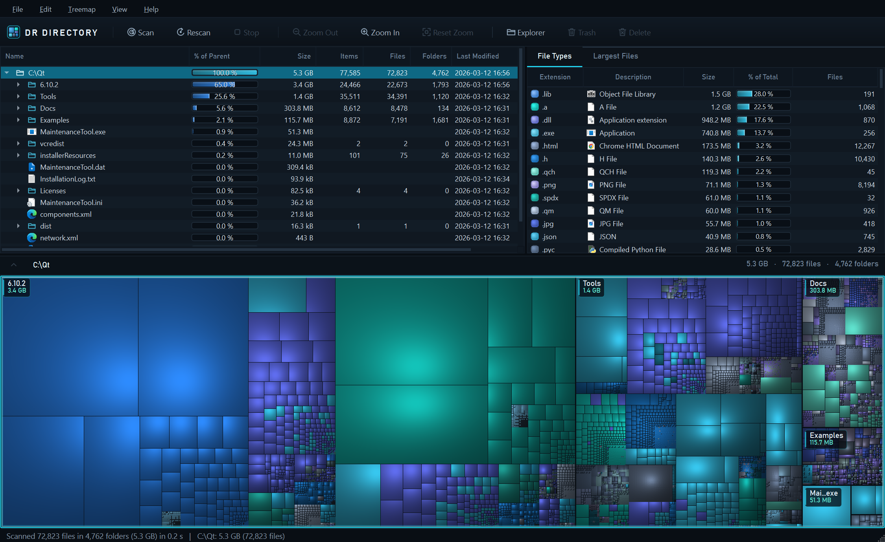
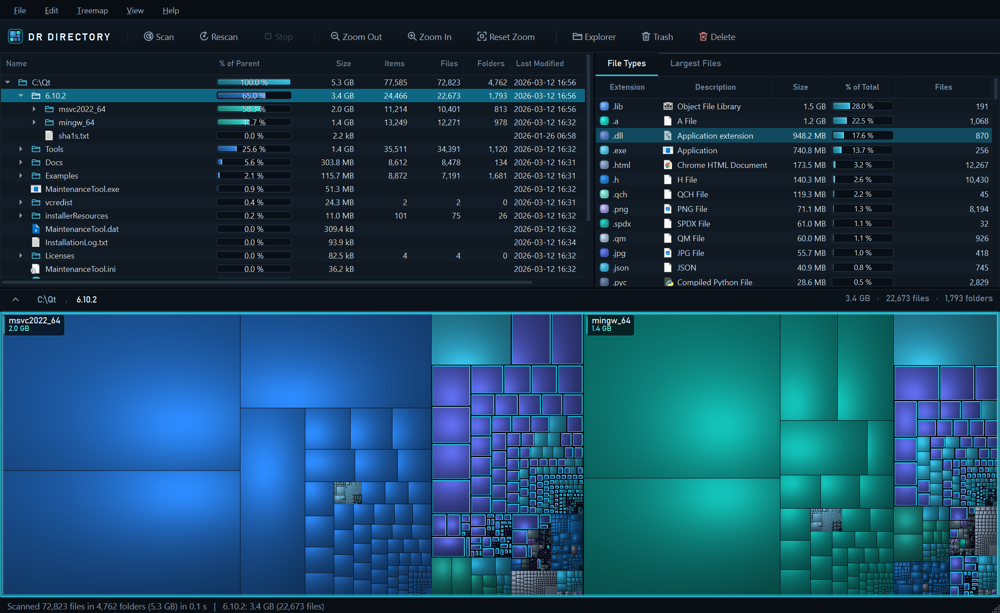
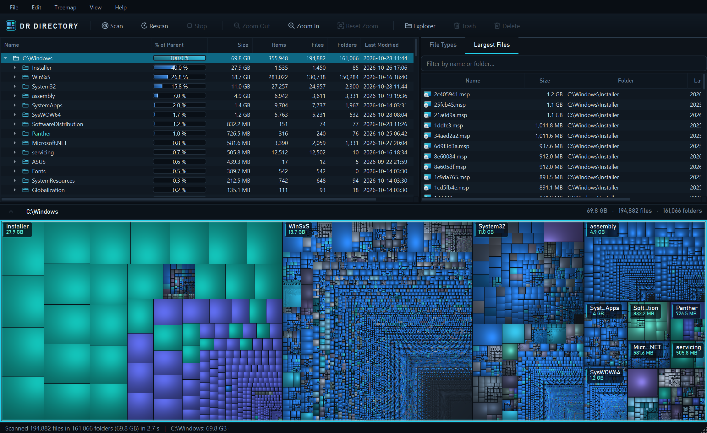
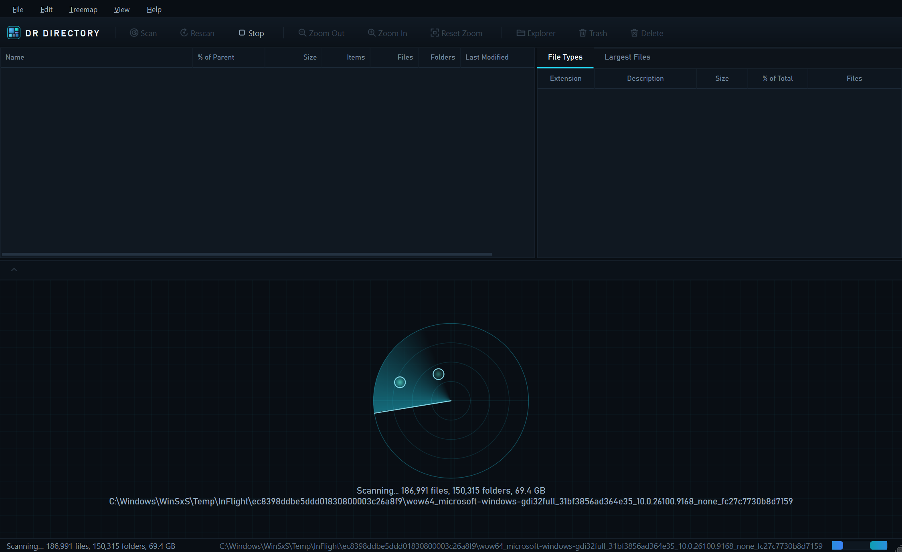

<p align="center">
  
</p>

<h1 align="center">DrDirectory</h1>

<p align="center">
  <b>See exactly what is eating your disk, and clean it up.</b><br>
  A fast, good-looking disk usage analyzer with a cushion treemap, in the spirit of WinDirStat, WizTree and
  TreeSize, for Windows, macOS and Linux.
</p>

<p align="center">
  <a href="https://github.com/glenwrhodes/DrDirectory/actions/workflows/build.yml"></a>
  <a href="https://github.com/glenwrhodes/DrDirectory/releases/latest"></a>
  
  
  
  <a href="LICENSE"></a>
</p>

<p align="center">
  
</p>

## Download

Grab the latest build from the **[Releases page](https://github.com/glenwrhodes/DrDirectory/releases/latest)**:

| Platform | File | Notes |
| --- | --- | --- |
| **Windows 10/11 (x64)** | `DrDirectory-<version>-windows-x64-setup.exe` | Installer with Start Menu entry and uninstaller |
| | `DrDirectory-<version>-windows-x64-portable.zip` | No install; unzip and run `DrDirectory.exe` |
| **macOS 12+ (Apple Silicon + Intel)** | `DrDirectory-<version>-macos-universal.dmg` | Drag to Applications. The build is not notarized: the first time, right-click the app and choose **Open**. |
| **Linux (x86_64)** | `DrDirectory-<version>-linux-x86_64.AppImage` | `chmod +x` and run. Works on most distros from 2022 on. |
| | `DrDirectory-<version>-linux-x86_64.tar.gz` | Plain binary tree (`usr/bin`, desktop file, icon) |

## Features

- **Fast multithreaded scanning.** It scans whole drives, any folder, or several at once, with live progress
  (a real percentage for whole volumes) and Esc to cancel. On Windows it uses `FindFirstFileEx` with large
  fetch and is long-path aware. On macOS and Linux it uses `openat`/`fstatat`.
- **Never double-counts.** Junctions, symlinks and pseudo-filesystems (`/proc`, `/sys`, snaps, container
  overlays) are not followed. On macOS the APFS data volume is counted once.
- **Folder tree.** Columns for name, % of parent bar, size, items, files, folders, newest modification date
  in the subtree, and attributes/permissions. Sort by any column; multi-select.
- **Cushion treemap.** Squarified layout with van Wijk cushion shading, coloured by file type and split into
  panels per top-level folder.
  - Click to select; hover for size and path.
  - **Drill down** with double-click or the mouse wheel; zoom out with Backspace, wheel-down or the mouse
    back button.
  - A breadcrumb bar jumps to any level.
- **File Types.** Size, share and count per extension, with system type names. Select a type to outline every
  file of that type in the treemap.
- **Largest Files.** The top 2,000 files in the scan, with an instant filter.
- **Cleanup.** Move to Recycle Bin / Trash (Del) or delete permanently (Shift+Del) for any multi-selection,
  with confirmation. Totals, tree, treemap and statistics update in place, with no rescan.
- **Space the scan can't see.** On volumes, an **&lt;Unknown&gt;** item shows used space the scan couldn't
  read (system areas, other users), and **&lt;Free Space&gt;** is optional.
- **Everyday tools.** Refresh one folder (F5) or everything (Ctrl+F5); Show in Explorer/Finder/File Manager;
  Open; Open Terminal Here; Copy Path; Properties; export any subtree to **CSV**; save the treemap as a
  **PNG**.
- Drag and drop folders onto the window, or pass them on the command line: `DrDirectory /home /data`.
- Remembers the window layout and options between runs.

<table>
  <tr>
    <td></td>
    <td></td>
  </tr>
  <tr>
    <td align="center"><sub>Drill-down with a file type highlighted</sub></td>
    <td align="center"><sub>Largest files</sub></td>
  </tr>
  <tr>
    <td colspan="2"></td>
  </tr>
  <tr>
    <td colspan="2" align="center"><sub>Scanning</sub></td>
  </tr>
</table>

## Keyboard shortcuts

| Keys | Action |
| --- | --- |
| Ctrl+O | Scan a drive or folder |
| F5 / Ctrl+F5 | Refresh the selected folder / rescan everything |
| Esc | Stop the scan |
| Del / Shift+Del | Move to Recycle Bin/Trash / delete permanently |
| Ctrl+E | Show in Explorer / Finder / File Manager |
| Ctrl+T | Open a terminal here |
| Ctrl+C | Copy path(s) |
| Alt+Enter | Properties |
| Ctrl+Z | Zoom the treemap to the selected folder |
| Ctrl+- / Ctrl++ / Ctrl+0 | Treemap zoom out / in / reset |
| Backspace, Enter, Home (treemap focused) | Zoom out / in / reset |
| F9 | Show or hide the treemap |

On macOS, Ctrl is Cmd.

## Building from source

You need **CMake 3.21+**, a **C++20** compiler and **Qt 6.8 or newer** (Widgets and Concurrent modules).
On macOS with a current Xcode, use **Qt 6.10+** (older Qt CMake files reference the removed AGL framework).

**Windows** (Visual Studio 2022 + Qt for MSVC):

```bat
build.bat
```

`build.bat` builds Release into `build\` and runs `windeployqt`. Set `QTDIR` if Qt isn't in
`C:\Qt\6.10.2\msvc2022_64`.

**macOS** (Xcode command line tools + Qt):

```sh
cmake -S . -B build -DCMAKE_BUILD_TYPE=Release -DCMAKE_PREFIX_PATH=~/Qt/6.10.2/macos
cmake --build build --parallel
open build/DrDirectory.app
```

**Linux**:

```sh
cmake -S . -B build -G Ninja -DCMAKE_BUILD_TYPE=Release -DCMAKE_PREFIX_PATH=~/Qt/6.8.3/gcc_64
cmake --build build
./build/DrDirectory
sudo cmake --install build   # optional: installs the binary, .desktop file and icon
```

Every push is built on all three platforms by [GitHub Actions](.github/workflows/build.yml). Each build is
smoke-tested with a headless scan (`DrDirectory --selftest <folder> <report>`), and on Windows the installer
itself is installed, tested and uninstalled. Pushing a `v*` tag publishes a release with all the packages.

## How it works

| Piece | Where |
| --- | --- |
| Threaded scanner (Win32 and POSIX) | [`src/Scanner.cpp`](src/Scanner.cpp) |
| In-memory tree, aggregation | [`src/FileNode.*`](src/FileNode.h) |
| Squarified cushion treemap | [`src/TreemapWidget.cpp`](src/TreemapWidget.cpp) |
| Tree / file type / largest-file models | [`src/DirTreeModel.cpp`](src/DirTreeModel.cpp), [`src/ExtensionModel.cpp`](src/ExtensionModel.cpp), [`src/LargestFilesModel.cpp`](src/LargestFilesModel.cpp) |
| OS integration (trash, file manager, terminal, volumes) | [`src/Platform_win.cpp`](src/Platform_win.cpp), [`src/Platform_unix.cpp`](src/Platform_unix.cpp) |
| Theme, vector icons, splash | [`src/Theme.cpp`](src/Theme.cpp), [`src/Icons.cpp`](src/Icons.cpp), [`src/Splash.cpp`](src/Splash.cpp) |
| Installers and packaging | [`packaging/`](packaging), [`.github/workflows/build.yml`](.github/workflows/build.yml) |

The treemap follows the squarified layout of Bruls, Huizing and van Wijk, shaded with the cushion technique
of van Wijk and van de Wetering (the same idea behind SequoiaView and WinDirStat).

The screenshots above come from the app's built-in capture mode:
`DrDirectory <folder> --capture docs/shot.png --size 1500x920 [--zoom <folder>] [--highlight dll] [--tab 1]`.

## Contributing

Issues and pull requests are welcome. Please keep changes cross-platform: OS-specific code belongs in
`Platform_*.cpp` or behind `#ifdef Q_OS_*` in the scanner. CI must stay green on all three platforms.

## Author

Created by **[Glen Rhodes](https://github.com/glenwrhodes)**, published by Tiny Moosh Games Inc.

## License

[MIT](LICENSE) © 2026 Tiny Moosh Games Inc.

DrDirectory uses [Qt](https://www.qt.io/), which is licensed under the LGPLv3. The release packages link Qt
dynamically and ship its unmodified shared libraries.
